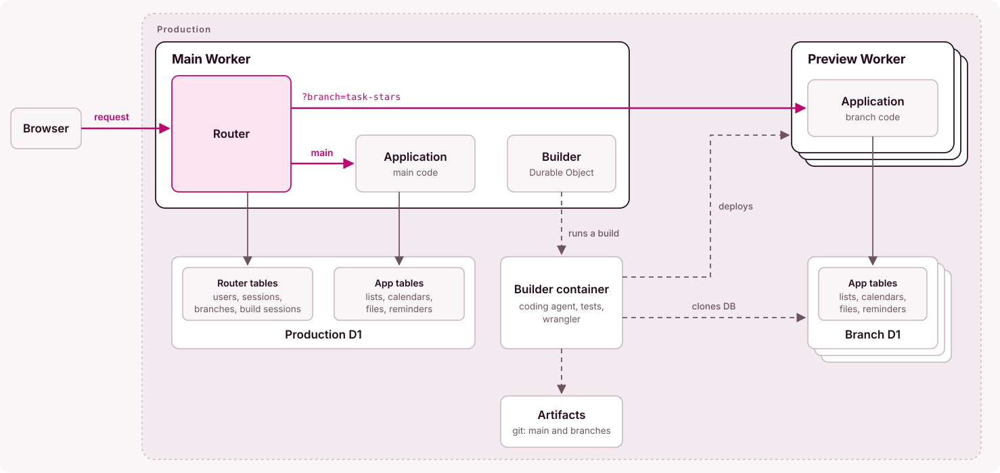

# Matron

> [!WARNING]
> This is a POC and not production ready. Expect bugs and frequent breaking changes. Use at your own risk.

A self-releasing family organizer app (A.K.A household manager).     
Matron lets your family manage their shared calendar events and tasks.    
Each user can be enabled to run claude code in a container to change and deploy the app itself.    
The users and admins can review the changes with live data inside the app and admins can merge the changes for everyone to use.

https://github.com/user-attachments/assets/2d40c9d1-7c7b-4d94-a3b5-ce1f061324e2

Matron runs as one Cloudflare Worker provisioned automatically with all the resources it requires via cloudflare.    
It uses:    
* Cloudflare artifact to keep the code alongside the app itself
* Cloudflare containers to run claude code and deploy changes to the code to the worker and artifact
* Cloudflare worker previews to route and expose multiple branches of the app 
* Cloudflare AI Gateway to connect to claude
* Cloudflare D1 to keep the data and fork off clones for different branches



The baseline of how self-releasing apps work can be found in [self-releasing-guide](https://github.com/cloudflare/self-releasing-guide).    
Other docs can be found in [docs](docs).

## Requirements

- A Cloudflare account on the Workers Paid plan.
- Anthropic api access through cloudflare AI Gateway (either through unified billing or provider keys) 
- Local development environment for first deploy with wrangler, node and docker

## Installation

Installing Matron means deploying it once from your machine. After that the app releases its own changes.

1. Clone the repository and install its dependencies (Node 22+ and pnpm 10+):

   ```sh
   git clone https://github.com/alonbardavid/matron.git
   cd matron
   pnpm install
   ```

2. Log wrangler in to your Cloudflare account. The deploy runs with this login:

   ```sh
   pnpm --filter @app/backend exec wrangler login
   ```

3. Create a Cloudflare API token for the app itself at <https://dash.cloudflare.com/profile/api-tokens>
   with the permissions listed in [docs/deployment.md](docs/deployment.md#before-the-first-deploy),
   and export it for the first deploy:

   ```sh
   export WORKER_API_TOKEN=...
   ```

   The token is stored on the Worker as a secret. The app deploys its own branches and reaches
   Claude with it, so it holds only what the running app needs, not what installing it does.

4. Give the account's `default` AI Gateway access to Anthropic: in the Cloudflare dashboard,
   under AI → AI Gateway → `default`, enable Unified Billing or store an Anthropic key under
   Provider Keys. If the gateway is not there yet, it is created by the app's first request
   to Claude; come back to this step then.

5. Start Docker and deploy:

   ```sh
   pnpm run deploy
   ```

   The first deploy creates everything the app needs (database, bucket, code repository,
   builder image), deploys the Worker, and asks for the owner's email, name and password.
   The Worker is named `matron` unless you pass `--name <worker>`; see
   [docs/deployment.md](docs/deployment.md) for the other flags.

6. Open the URL printed at the end, sign in as the owner, and add the rest of the household
   from user management.

## Develop

```sh
pnpm install
pnpm db:migrate        # local D1
# apps/backend/.dev.vars: CLOUDFLARE_ACCOUNT_ID and CLOUDFLARE_API_TOKEN, for the planner
pnpm dev               # worker on :8301, SPA on :5173
pnpm test              # Playwright e2e
```

## Deploy

```sh
pnpm run deploy
```
