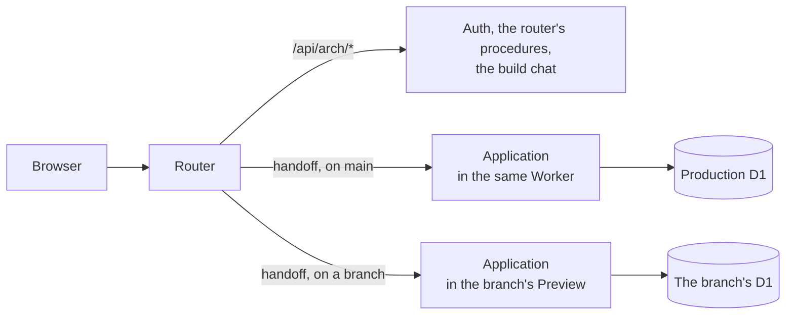
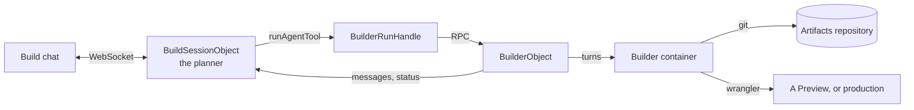

# Router architecture

Matron is one Cloudflare Worker with three parts. The **router** signs people in and decides which branch of the code answers a request. The **builder** changes the code and releases it. The **application** is the household app itself.

This page is about the router and the builder: everything that makes the app self-releasing. [`SELF-RELEASING-GUIDE.md`](../SELF-RELEASING-GUIDE.md) explains the pattern and how each part behaves; this page says where Matron's code for it is and how a request moves through it. The application is in [app-architecture.md](app-architecture.md), what it does in [app-product-guide.md](app-product-guide.md), and deploying in [deployment.md](deployment.md).

| Part        | Runs                                               | Code                                                             |
| ----------- | -------------------------------------------------- | ---------------------------------------------------------------- |
| Router      | In production only                                 | `apps/backend/src/router.ts`, `backend/arch-*`                   |
| Application | In production, and alone in every branch's Preview | `apps/backend/src/application.ts`, the other `backend/` packages |
| Builder     | In production: a Durable Object and its container  | `backend/arch-builder`, `apps/builder` (the image)               |

## A request

1. `apps/backend/src/index.ts` picks the router or the application by `WORKER_ROLE`. A Preview runs this same Worker with `WORKER_ROLE=application`, so its entry skips the router and serves the application only.
2. The router (`apps/backend/src/router.ts`) mounts better-auth at `/api/arch/auth/*`. For everything else it resolves the session cookie into a `Principal` (`backend/arch-auth/src/session.ts`) and the branch from `?branch=` or the referer (`backend/arch-routing/src/branch-param.ts`).
3. It hands the build chat socket at `/api/arch/sessions/:sessionId/ws`, and what the chat asks for below it, to the session's Durable Object (`sessionProxyRoute` in `backend/arch-api/src/routes/sessions.ts`, through `backend/arch-sessions/src/proxy.ts`).
4. It serves the rest of `/api/arch/*` itself through `backend/arch-api`, the routes and handler for the `shared/contract/src/arch` contract. A path there that no procedure claims is a 404.
5. Every other path belongs to the application. A signed-out request gets the SPA, which shows the sign-in screen, and the public procedures under `/api/app/public/`, both from main; any other `/api/*` path answers 401. A request naming a branch that does not exist gets `apps/backend/static/branch-not-found.html` from the Worker's assets.
6. `backend/arch-routing/src/handoff.ts` passes the request on: the session cookie stripped, and the principal (or none, when signed out) and the branch signed into the handoff header (`signed-handoff.ts`). On main that is an in-process `application.fetch`; on a branch it is the same request sent to the branch's Preview URL.

better-auth also offers the providers the household has set up in App settings (Google): a member links their account there, and the application asks for a valid access token through `backend/arch-auth/src/app-interface.ts`, the one file of the auth that application code imports. The household's Google app is two secrets of the Worker, set from App settings through Cloudflare's API (`backend/arch-settings/src/worker-secrets.ts`).

## The packages

| Package                                                    | What it owns                                                                                                            |
| ---------------------------------------------------------- | ----------------------------------------------------------------------------------------------------------------------- |
| `backend/arch-api`                                         | The router's procedures and their handler.                                                                              |
| `backend/arch-auth`                                        | better-auth: signing in, user management, linked accounts.                                                              |
| `backend/arch-routing`                                     | The branch a request names, the signed handoff, and the page for a branch that does not exist.                          |
| `backend/arch-branches`, `frontend/branches`               | The branch rows, their names and states; the branch switcher and a branch's merge and abandon actions.                  |
| `backend/arch-sessions`, `frontend/build`                  | Build sessions: the rows, the session's Durable Object and its chat; the build chat and the Builds page.                |
| `backend/arch-planner`                                     | The planner's prompts (`prompts/`) and its repository tools.                                                            |
| `backend/arch-builder`                                     | The builder's Durable Object, its runs and the container harness. Its `README.md` lays out the moving parts.            |
| `apps/builder`                                             | The builder image: the harness's daemon, the step commands, the coding agent's prompts and hook.                        |
| `backend/arch-repository`                                  | The code repository in Artifacts: reading, searching, diffs, tokens, and mirroring upstream.                            |
| `backend/arch-review`, `frontend/review`                   | Reading a branch's code before merging it, and asking about it.                                                         |
| `backend/arch-upstream`, `frontend/upstream`               | Checking the upstream repository for updates and starting the build that merges them.                                   |
| `backend/arch-settings`, `frontend/settings`               | The models and the household secrets; the App settings page.                                                            |
| `backend/arch-troubleshooting`, `frontend/troubleshooting` | The deployment's own resources, read from Cloudflare's API: databases, containers, branches; reverting a merged branch. |
| `frontend/auth`                                            | The sign-in and Users screens.                                                                                          |

Who may do what on the router's side is declared like any feature's, in each package's `src/permissions.ts`:

| Resource          | Actions                   | Who                                           |
| ----------------- | ------------------------- | --------------------------------------------- |
| `branch`          | `view`, `create`, `merge` | Owners all three; admins `view` and `create`. |
| `review`          | `view`                    | Owners.                                       |
| `settings`        | `manage`                  | Owners.                                       |
| `troubleshooting` | `manage`                  | Owners.                                       |
| `upstream`        | `check`, `merge`          | Owners.                                       |

A member has none of them: they use main only, and see neither the branch switcher nor the Build button.

## Building

### The session and the planner

`POST /api/arch/sessions` creates a session row. The app offers a new one on main only: a tab on a branch has that branch's session and no other, which is what the Build button opens there.

The chat is a WebSocket to the session's `BuildSessionObject` (`backend/arch-sessions/src/session-object.ts`), a Think agent like the assistant's, named by the session id. The planner is its model, through the gateway on the household's builder-model setting, with the repository tools (`backend/arch-planner/src/tools.ts`) and the session's own: `propose_plan` records the plan and the branch name, `start_build` starts the build, `tell_builder` passes the member's words (and the files of their latest message) to the builder.

Which tools a turn may call, and the system prompt, depend on the session's phase (`backend/arch-planner/src/prompts.ts`), which the object syncs to its clients as state. While planning, the prompt carries [app-product-guide.md](app-product-guide.md) and [app-architecture.md](app-architecture.md) in full, as they were when the Worker was built. The browser side (`frontend/build`) is the Think chat client, with `useAgentToolEvents` for the runs.

### Runs

A build, a merge, an abandon or a revert is a run of the builder as the session's sub-agent (`runAgentTool` with `BuilderRunHandle`, `backend/arch-builder/src/run-handle.ts`): a detached run that outlives the turn, is watched by the session's own reconcile loop after an eviction, and whose lines stream to the chat as the run's chunks beside the planner's reply. `backend/arch-builder/src/runs.ts` makes each kind of run, and `protocol.ts` lists the steps each one takes. A build is type-checked and built, and its tests are the ones the coding agent judged its change might affect. A merge runs the whole suite on the merged code before it pushes main, migrates the database or deploys, and stops there if anything fails.

The handle is a facet child of the session with no container of its own: it forwards the four agent-tool methods to the `BuilderObject` (`backend/arch-builder/src/builder-object.ts`), the Durable Object that owns the builder container and keeps each run's record and lines in its SQLite (`runs`, `run_chunks`), tailing them live over an RPC stream.

The builder's messages and status go the other way, over RPC on the session object through the `BuildSessionLink` interface it declares (`session-link.ts`): a message joins the conversation on the member's side, marked as the builder's, so the planner reads it as said to it; a status moves the session's phase and rows. The builder never imports the sessions package.

A revert takes production back to where a merged branch was cut: main to the branch's base commit, the production database to the time the branch was created, then a deploy. An owner starts it from Troubleshooting (`revertBranch` in `backend/arch-troubleshooting/src/service.ts`), and nothing records it.

### The container

The builder object is an Agent whose container harness (Agents SDK) owns the builder container: it starts it from the image, runs every turn the object submits as a durable operation, streams the turn's events, reattaches after an eviction, and snapshots the workspace when the container has idled five minutes. A run is a fiber in the object: a sequence of turns, each a step command or a turn of the coding agent, checkpointed after each, so an evicted object resumes the run from its last checkpoint.

The image (`apps/builder`) is the harness's daemon with an adapter for both kinds of turn: a step runs `cli.ts`, an agent turn runs the coding agent's CLI in the checkout, with a hook (`hook-guard.ts`) that enforces the runner's rules and model calls routed through the harness's egress, which adds the gateway and its credentials outside the container. A question from the agent parks the run until the user replies.

### The repository, the review and upstream

- The code repository (Artifacts) is reached only through `backend/arch-repository/src/service.ts`: main's head, the file listing, reading and searching behind the planner's tools (at any ref), the tree diff and commit log behind the review, and the token a builder clones with. It can also pull a branch of a public repository into one of its own and say what main lacks of it (`mirror.ts`, isomorphic-git over `node:fs`, whose `/tmp` in a Worker is memory that lasts for the request).
- The review (`backend/arch-review`, `frontend/review`) reads a live branch's diff against its `base_commit`, the builder's commit messages (`commits.ts`), and the summary and brackets the builder agent gave with the newest deploy, which the build session object keeps (`reviewReport`). The browser diffs each file itself (`frontend/review/src/diff.ts`) and keeps viewed marks in `localStorage`. Questions go to the planner's model call with the branch's tools (`reviewer.ts`); the client sends the whole conversation each time and nothing is stored.
- Upstream updates are `backend/arch-upstream`: where upstream is (`source.ts`), the check that pulls it into the repository's `upstream/main` branch and compares main with it, and the start of the build session that merges it, with the plan under `prompts/`. It reaches the session through `getSession` in the sessions service, which returns the session's Durable Object. The screen side is `frontend/upstream`, a widget on Troubleshooting's Branches tab.

## Configuration

`apps/backend/wrangler.jsonc` is for local development only. Deploys stamp a target onto the config the build emits (`scripts/gen-wrangler-config.mjs`): production binds the production D1 and declares the builder container; a preview config binds the branch's D1 under a `previews` block and declares no container. See [deployment.md](deployment.md).
